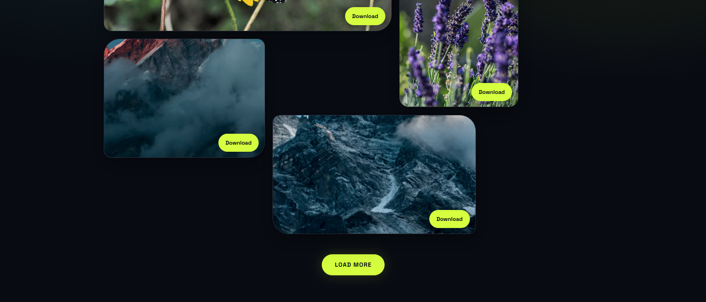

# 🌌 NeonFrame Gallery

A modern, responsive image gallery featuring a dark interface, neon accents, an asymmetrical layout, and randomly loaded photos.

## ✨ Features

- 🖼️ Responsive image gallery for desktop, tablet, and mobile
- 🎲 Load more random images with one click
- ⬇️ Download controls for gallery images
- 🌈 Dark theme with neon lime and electric cyan accents
- ✨ Smooth hover effects and image entrance animations
- ♿ Reduced-motion accessibility support
- 📱 Mobile-friendly layout

## 🛠️ Technologies Used

- HTML5
- CSS3
- JavaScript (ES6+)
- Google Fonts
- Picsum Photos, Pixabay, and Unsplash

## 📸 Screenshot



## 📂 Project Structure

```text
NeonFrame-Gallery/
├── index.html
├── style.css
├── script.js
├── screenshot.png
└── README.md
